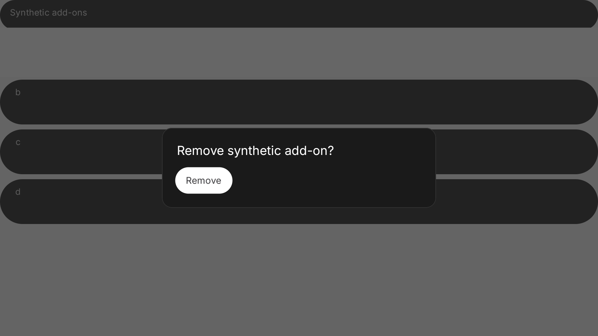
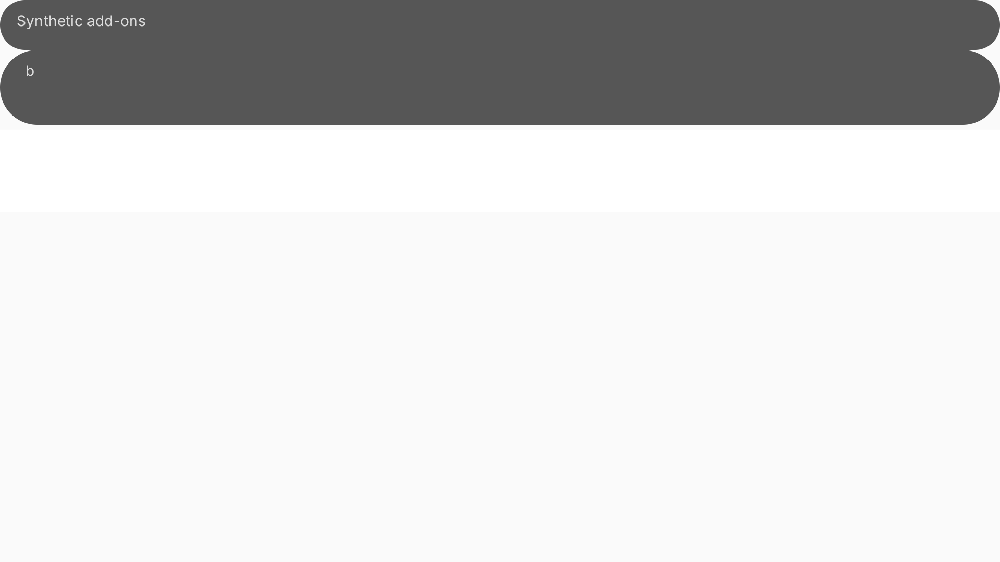
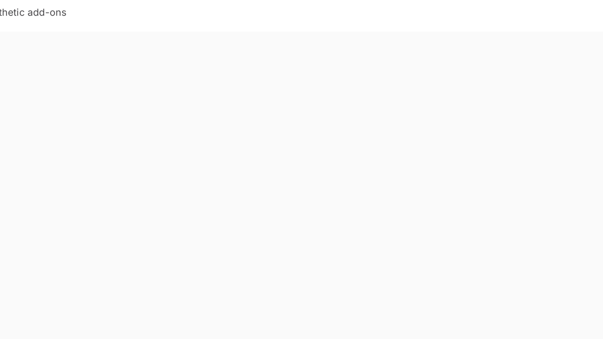

# Addon-removal crash proof

Android 36 TV emulator; synthetic addon identifiers only. The fixture uses the real
`TvReorderList`, `NuvioDialog`, focus-restoring modifier and Compose runtime. Its
map-backed renderer deliberately uses the same strict `getValue` lookup as
`AddonManagerScreen`. This is a component reproduction, not a screenshot of a
customer's addon installation.

- Before: the first removal fails with `NoSuchElementException` and leaves the
  confirmation frame visible. The test cannot proceed to the remaining removals.
- After: first and middle removals complete, leaving `b` and `d`; the final two
  removals then return focus to the permanent header. There is no visual redesign.
- The screenshots are unedited ADB captures from a separate one-method evidence
  run. Its baseline failed with the same missing-key exception and its fixed run
  passed. The full four-case logs below are the earlier, definitive comparison.

## Identical-binary comparison

The same compiled instrumentation APK was installed for both app builds:
`EA0990FAE93FA963C35AB85D7F611512D7B4F4D21713E2C8E9DB49AC204D3063` (SHA256).

- [Baseline log](baseline-final-instrumentation.log): all four tests fail with the
  actual missing-key exception (`fixture-18`, `a`, `a`, `b`).
- [Fixed log](fixed-instrumentation.log): `OK (4 tests)` in 26.683 seconds.
- [Baseline receipt](baseline-final-result.json) and [fixed receipt](fixed-result.json)
  record exact APK/fixture source commits and hashes.

The baseline APK was built at `1b331ff293c0b08c8793316735e564f6f54b23fe`;
its production list and addon-screen code match dev
`7a9b0b827e2b80dbe356381c91a648725930a8c1`. The fixed production APK was built
at `51a247557c4331c3a442ed008e9ac2d7b37cb63f`; its production source is
identical to PR head `2e5a126123368768ff7a333cf7cb4727637c8222` (the last
commit adjusts only the test fixture's focus handoff before viewport jumps).

The privately compiled fixture source includes an unrelated diagnostic class, but
both comparisons explicitly selected only
`com.nuvio.tv.ui.components.TvReorderListAddonRemovalTest`.
Only the four focused PR files are proposed for merging; these proof artifacts
remain on this separate fork branch.
