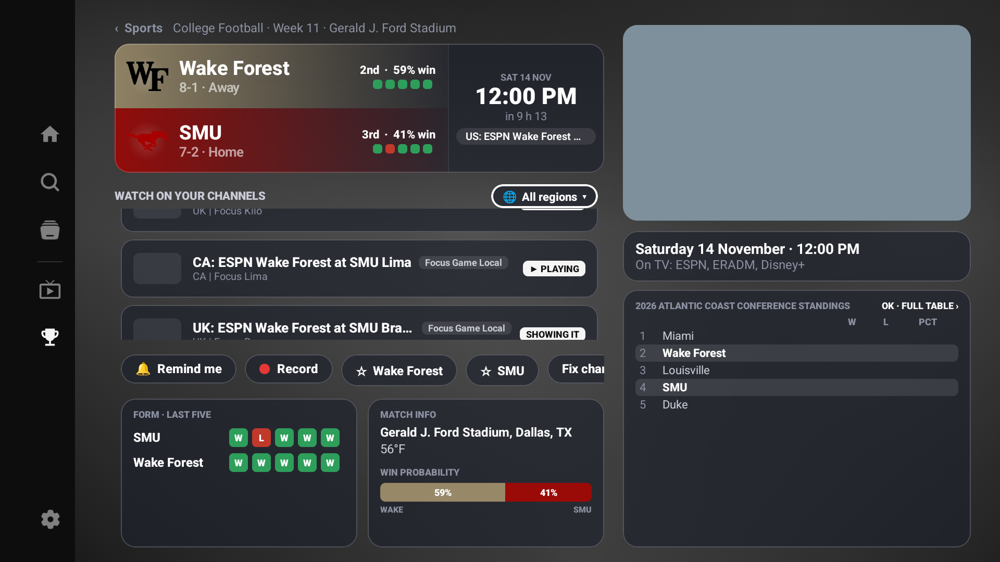
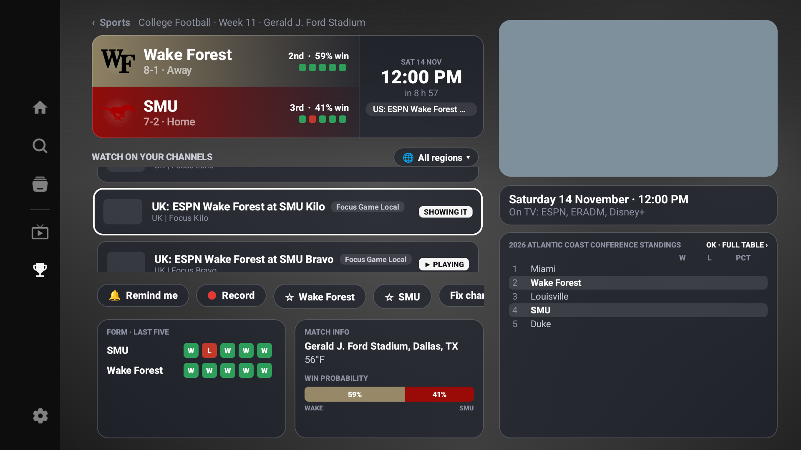

# TV Sports stream focus evidence

Baseline: `e4d3d6e801c79835e53d3d967339268029f587b2`.

Fix: `a018b5d9` (the stream-entry requester is attached to the list's existing focus group, ahead of `keepFocusWhileHeld`, rather than to the recycled first row).

The normal TV app was built and installed with an isolated preview application ID on an Android TV emulator (Android 16 / API 36, x86_64, 1920 × 1080). Screenshots are from the actual Sports detail page, navigated with ADB D-pad key events. They are not a standalone UI mockup.

The preview imported 24 synthetic M3U/XMLTV channels, forming 12 distinct matched stream groups for the public Wake Forest @ SMU schedule entry. Playback used silent local sample video. This checks navigation; it does not validate an IPTV provider, a real sports broadcast, or a physical Fire TV.

The preview encountered unrelated pre-Sports startup timeouts on this emulator. The baseline reached the UI on a normal warm relaunch. The fixed install reached the UI after Android's package-scoped ART speed compilation and a normal launch; no startup timeout or application code was changed to bypass the watchdog. These runs make no startup or performance comparison claim.

## Before

Scroll until row 0 (Golf) is no longer composed, select the later Lima stream, enter fullscreen, wait more than three seconds, then press Back. Navigate from the team panels to All regions and press Down repeatedly.

`before.png` shows All regions focused while later streams remain visible. The matching `before.xml` has `focused="true"` on All regions. `before-focus-warnings.txt` records the app's `FocusRequester is not initialized` warning on failed Down requests.

## After returning from playback

The fixed build entered the fullscreen Live TV player with a later stream selected. `fixed-player.xml` records the focused player root at `[0,0][1920,1080]`, the Bravo stream title, and the `360P · 24 FPS` information bar. After waiting more than three seconds and pressing Back once, the retained stream viewport still showed later rows; focus landed on the visible Kilo stream row, above Bravo.

`after-return.png` and `after-return.xml` show the actual stream row focused at `[223,451][1157,565]`. Golf, the first stream row, remains outside the stream viewport; its name can still appear separately in the header's channel summary.

The fix preserves reachability and scroll position. It does not promise that the exact last-selected stream receives focus.

## Remote navigation checks

- Initial game entry focused the first stream (Golf).
- After returning from playback with the list scrolled, navigation from Wake Forest to SMU to All regions to streams focused the visible Kilo stream. `after-down.png` and `after-down.xml` capture the actual row focus after the final Down press.
- Repeated Down reached the 12th and last stream group, Lima (`last-row.png`, `last-row.xml`). Another Down left the list for the Wake Forest follow action.
- Moving back up reached Golf. One Up from Golf reached All regions (`first-up.png`, `first-up.xml`), preserving the existing first-row Up link.

The additional queued fast-return attempt was inconclusive because the navigation transition had not settled when queued Back inputs ran. No fast-return result is claimed.

The baseline and fixed full-debug APKs both built successfully. This branch contains only review evidence; the product fix is on the separate `fix/sports-stream-focus-return-20261114` branch.
